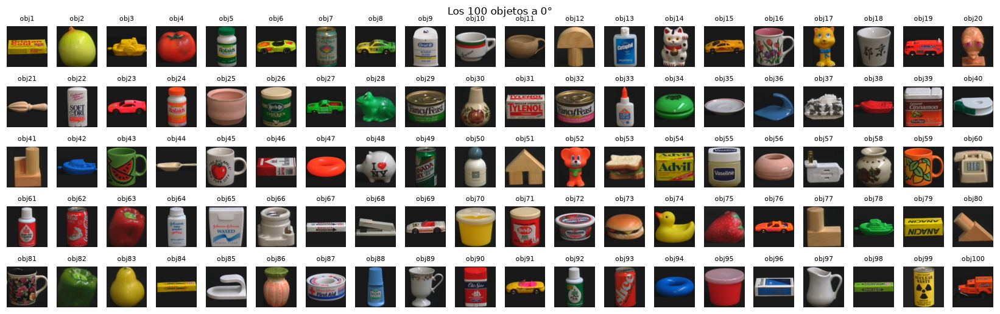
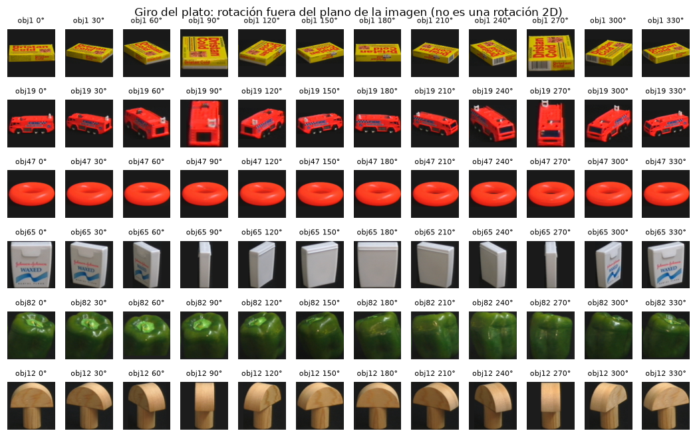
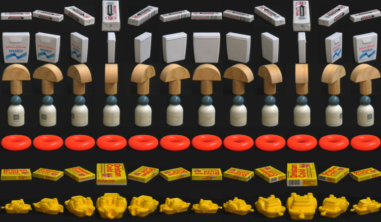

# 2. Dataset y análisis exploratorio

## 2.1 Estructura

| Propiedad | Valor medido |
|---|---|
| Imágenes | 7.200 PNG, RGB, 128×128 |
| Objetos × vistas | 100 × 72; ángulos 0°–355° cada 5°; conjunto completo |
| Duplicados exactos | 0 |
| Tamaño en disco | 138 MB (el ZIP oficial ronda 125 MB) |
| Archivos ajenos | `convertGroupppm2png.pl` y `convertGroupppm2png.pl~` (script de conversión PPM→PNG; se ignoran) |
| Huella de versión de datos | `4e39f8783785bc2d` (sha256 truncado sobre nombres y bytes; `linevision.data`) |
| Nombre de archivo | `obj{N}__{ÁNGULO}.png`; el 0° de cada objeto es la posición inicial del plato |

Origen: Nene, Nayar y Murase, *Columbia Object Image Library (COIL-100)*, Technical Report CUCS-006-96, 1996
(Columbia CAVE). Catálogo alternativo: TensorFlow Datasets `coil100`. Nota: la entrada BibTeX de TFDS cita el
informe CUCS-005-96 con título de COIL-20; es una inconsistencia de esa ficha.

## 2.2 Propiedades medidas

| Medida | Valor | Fuente |
|---|---|---|
| Fondo (media RGB de esquinas 8×8) | [26,4; 26,4; 25,9], desviación [4,1; 3,9; 2,7] | fase 1 |
| Fondo, percentil 99 del máximo de canal | 53 | fase 1 |
| Fracción de primer plano (umbral 60) | media 0,462; mínimo 0,123; máximo 0,881 | fase 1 / notebook |
| Fracción de primer plano (umbral 80) | media 0,420; mínimo 0,099; máximo 0,830 | fase 1 |
| Imágenes donde el objeto toca el borde | 60,1 % (umbral 60), 31,6 % (umbral 80) | fase 1 |
| Variación del área con el giro (CV mediano por objeto) | 0,09 (umbral 40), 0,102 (umbral 60) | fase 1 / notebook |
| Objeto con mayor variación de área | obj44 (CV 0,63) | fase 1 |
| Intensidad media por objeto | de 40,6 a 100,7 | fase 1 |

Con umbral 40 "todas" las imágenes parecían tocar el borde: el ruido del fondo supera 40. Por eso el umbral de
primer plano quedó en 60.

## 2.3 Propiedades que condicionan el diseño

| Propiedad | Evidencia | Consecuencia |
|---|---|---|
| **Rotación sobre el eje vertical (plato), 1 grado de libertad** | Vistas de cada objeto a lo largo del giro | El ángulo es una pose fuera del plano: rotar la imagen en 2D no lo simula ni lo mide. Las apariencias forman un lazo cerrado → modelo del plato |
| **El 0° es arbitrario por objeto** | El 0° es la posición inicial del plato | El ángulo es relativo a la vista de referencia de cada SKU: la pose se estima condicionada a la clase; un SKU nuevo necesita su propia galería |
| **Objetos simétricos** | obj47 (rosca) invariante; obj65 (hilo dental) y obj67 (chicles) ambiguos a 180°; obj12 (seta de madera) simetría especular | Métrica circular **y** consciente de simetría; incertidumbre que pueda ser multimodal; no inventar un ángulo inobservable |
| **Imágenes normalizadas en tamaño** | El objeto llena el encuadre; la caja obj1 vista de canto aparece "agrandada" | La escala aparente cambia con el giro y no es fiable; en planta habrá que replicar esta normalización |
| **Fondo oscuro no negro** | ~26/255 con ruido, p99 = 53 | Umbral de primer plano en 60 |
| **Vistas a 5° casi idénticas** | Distancias mínimas entre vecinas | Nunca K-fold aleatorio: validación por bloques de ángulo u objeto |
| **Pares visualmente cercanos** | Coches rojos, objetos amarillos, piezas de madera | Confusiones de clase y riesgo de aceptar "gemelos" desconocidos |

*Filas: obj67, obj65, obj12, obj50, obj47, obj1, obj3 cada 30°. Se ven la caja de chicles y la de hilo dental casi
iguales a 180°, la rosca invariante y la caja obj1 reescalada al verla de canto.*

## 2.4 Baselines triviales (fase 1, diagnóstico de dificultad)

Primer diagnóstico con 1-NN sobre píxeles 32×32 (y sobre histograma HSV) sin ningún hiperparámetro ajustado. Se
hizo sobre las particiones de los protocolos antes de construir la validación interna; ningún modelo se eligió
con estos números, que solo sirvieron para dimensionar el problema. El ángulo se mide dentro de la clase correcta.

| Protocolo | Exactitud de clase | Ángulo dentro de ±10° | Error medio del ángulo | Errores > 90° |
|---|---|---|---|---|
| A, píxeles | 99,97 % | 97,8 % | 6,1° (mediana 5,0°) | 0,5 % |
| A, HSV | 99,92 % | 90,7 % | 8,6° | 1,4 % |
| C, píxeles | 97,38 % | 76,0 % | 14,2° (mediana 10,0°) | 3,1 % |
| C, HSV | 99,63 % | 69,4 % | 16,0° | 3,4 % |
| B, píxeles (arco aleatorio, semilla 0) | 92,33 % | 28,8 % | 64,5° (mediana 25,0°) | 30,1 % |
| D, píxeles (distancia 1-NN como novedad) | AUROC 0,997; 0 % de desconocidos aceptados al 95 % de conocidos | — | — | — |

- **B tiene un techo estructural**: un oráculo que devolviera el ángulo observado más cercano cumpliría ±10° solo
  en un tercio del arco (error medio 17,5°). B está diseñado para medir si el sistema sabe abstenerse.
- **Objetos con peor ángulo en A**: obj67 (error medio 52,2°, 28 % de giros > 150°), obj65 (33,3°, 17 %), obj12
  (14,4°), obj50 (11,9°), obj94, obj25, obj47, obj95. Solo 2 objetos superan 20° de error medio; 84 están en ≤ 5°.
- **Confusiones más frecuentes en C (píxeles)**: 1→3 (8), 76→23 (7), 15→3 (6), 19→75 (5), 21→80 (5), 65→22 (5),
  68→65 (5), 84→83 (5). Son pares de color y silueta parecidos.
- En D, los 10 objetos excluidos con semilla 0 fueron 6, 8, 23, 30, 34, 37, 67, 73, 76 y 85. El valor parece
  "fácil" pero depende mucho de qué objetos se excluyan.

**Conclusión de la fase 1**: clasificar es casi trivial; la dificultad real está en el ángulo con extrapolación o
escasez, la confianza calibrada y el rechazo, la simetría, el rigor experimental y la brecha con planta.

## 2.5 Diferencias con un entorno real de planta

| COIL-100 | Planta | Cómo se aborda |
|---|---|---|
| Un objeto centrado y recortado | Posición y escala variables, varios objetos | Etapa previa de segmentación y normalización equivalente a la de COIL (pendiente: ver sección 9) |
| Iluminación fija de laboratorio | Deriva de iluminación, suciedad en la cámara | Monitorizar la puntuación de novedad; calibrar con variaciones nominales; normalización fotométrica (sección 9) |
| Solo giro vertical | Objetos volcados o inclinados | Fuera de dominio: debe acabar en UNKNOWN o REVIEW, nunca en un ángulo inventado |
| Galería completa de 72 vistas | Alta de SKU con pocas vistas | Protocolo C y certificación de cobertura angular por SKU |
| Sin oclusión ni desenfoque | Movimiento en la cinta | Control de calidad de imagen antes de inferir (Reto 3) |
| Resolución 128×128 | Cámara industrial de más resolución | El método funciona a 32×32 para pose; más resolución no es un obstáculo |
