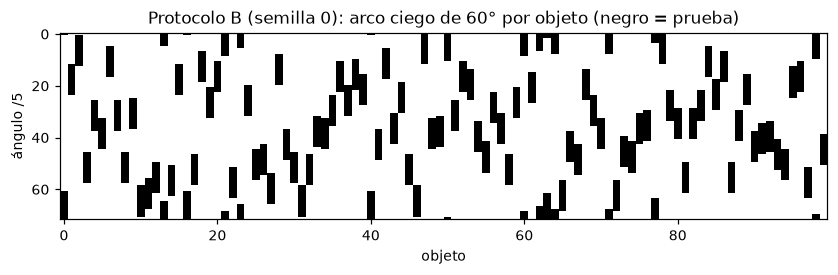

# 3. Protocolos y validación

## 3.1 La idea clave

Un protocolo **no** es un problema distinto que se resuelva con otro modelo: es una forma distinta de repartir las
fotos entre entrenamiento y prueba, pensada para estresar una capacidad. En los cuatro protocolos se usa **el mismo
sistema y el mismo código**; cambia solo con qué fotos se entrena. Por cada protocolo:

1. Se entrena con sus vistas de entrenamiento (clasificador, curvas del plato, galería).
2. Los umbrales se calibran con validación interna construida solo con vistas de entrenamiento.
3. Se evalúa sobre su prueba, sin ajustar con ella ningún umbral, y se reporta por separado. El control de seguridad
   se evaluó dos veces en prueba (v1 y v2, sección 7.5); los modelos de identidad y de ángulo no cambiaron entre las
   dos.

Regla del enunciado: ningún hiperparámetro se ajusta sobre la prueba; la validación sale exclusivamente de las
vistas de entrenamiento.

## 3.2 Los cuatro protocolos

| Protocolo | Entrena / prueba | Pregunta que hace | Pieza que estresa | Qué recibe el robot |
|---|---|---|---|---|
| **A — Interpolación** | 0°, 10°, 20°… (36 por objeto) / 5°, 15°… (36) | ¿Estimas bien entre vistas conocidas? | El plato en su caso fácil | Clase + ángulo; actúa |
| **B — Sector ciego** | Todo excepto un arco contiguo de 60° por objeto (60 vistas) / el arco (12) | ¿Qué haces ante una cara nunca vista? | El plato fuera de su zona y el rechazo | Clase + "ángulo no certificado" → 2a captura o manual |
| **C — Escasez** | 1 vista cada 30° (12) / las 60 restantes | ¿Funciona un producto nuevo con pocas fotos? | Clasificador con pocos datos y plato con muestreo escaso | Actúa si la incertidumbre lo permite; si no, revisión |
| **D — Desconocido** | 90 objetos / 10 objetos excluidos por completo | ¿Sabes decir "no lo conozco"? | El rechazo; el plato no aplica (sin curva) | "Desconocido" → carril de rechazo |

| | Clasificador | Plato | Rechazo / control | Top-k |
|---|---|---|---|---|
| A | fácil | **principal** (interpola) | poco | vistas del SKU cercanas en ángulo |
| B | fácil | **límite** (no extrapola) | **principal** (política de cobertura) | evidencia de foto sin referencias cercanas |
| C | **exigido** | exigido | exigido | menos vistas que mostrar |
| D | — | no aplica | **principal** | vecinos en apariencia y su distancia |

Tamaños (comprobados por test unitario): A 3.600/3.600; B 6.000/1.200; C 1.200/6.000; D 6.480/720.

## 3.3 Decisiones sobre lo que el enunciado no fija

- **B**: el inicio del arco es aleatorio por objeto, sobre la rejilla de 5°, con semilla. Se repite con 3 semillas
  (2026, 2027, 2028) y se reporta media ± desviación.
- **D**: 10 objetos elegidos al azar con semilla; 3 repeticiones. Objetos excluidos: (3, 8, 17, 35, 36, 37, 45,
  61, 64, 78), (1, 8, 14, 28, 37, 45, 47, 49, 58, 91) y (23, 33, 34, 36, 52, 56, 71, 85, 96, 97). En el análisis se
  probó además un escenario adverso de "gemelos" (excluir un miembro de pares parecidos).
- **D sin conocidos en prueba**: rechazar todo daría 100 % de rechazo. La tasa de conocidos rechazados y la
  separación conocidos/desconocidos se miden en validación interna.

## 3.4 Validación interna sin fugas

Las vistas a 5° son casi duplicados: un K-fold aleatorio filtraría información. Se parte siempre por bloques de
ángulo u objeto, imitando cada protocolo (`linevision.protocols.inner_splits`):

| Protocolo | Particiones internas (solo vistas de entrenamiento) | Nota |
|---|---|---|
| A | 2 pliegues: entrena 0°, 20°, 40°… / valida 10°, 30°…, y al revés | Espaciado doble: más exigente que la prueba real |
| B | 3 pliegues: otro arco de 60° dentro de los 300° vistos, desplazado 30°, 120° o 210° desde el final del arco externo | Cada pliegue interno tiene dos huecos: más exigente |
| C | 2 pliegues: entrena 0°, 60°… / valida 30°, 90°…, y al revés | Huecos de 60°: mucho más exigente que la prueba (30°) |
| D | 3 pliegues: 10 objetos de catálogo hacen de desconocidos; los conocidos se validan como en A | Grupos disjuntos de los objetos de prueba |

En la iteración v2 se añadió `covered_splits`: alternancia de vistas consecutivas del entrenamiento (A: pasos de
10°; B y D: pasos de 5°; C: pasos de 30°) para calibrar la incertidumbre del ángulo **en el régimen con cobertura**.
El sector ciego no se calibra con incertidumbre porque lo gobierna la regla determinista de cobertura del SKU.

Garantías comprobadas por tests: ninguna partición interna toca la prueba; los desconocidos internos de D nunca
coinciden con los desconocidos de la prueba; las particiones de cobertura alternan sin tocar la prueba.

## 3.5 Lo que esto implica para leer los resultados

- La validación interna es **deliberadamente más dura** que la prueba en A y C. Calibra umbrales conservadores; la
  contrapartida (visible en C) es que el sistema puede negarse a actuar aunque acierte.
- En B, la cifra de "una imagen" (ángulo en el arco ciego) es intrínsecamente baja; lo que se demuestra es que el
  sistema no actúa sobre SKUs sin cobertura y que una 2a captura recupera el ángulo.
- En D, la métrica principal es la tasa de desconocidos rechazados y de acciones inseguras.
