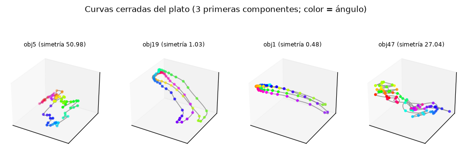
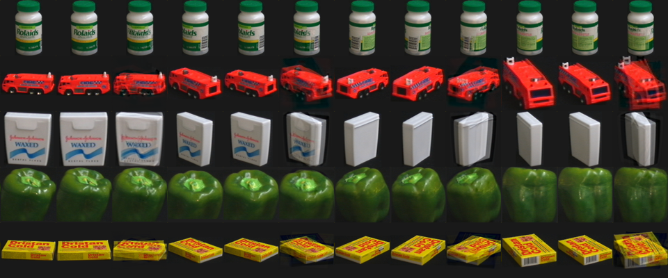

# 5. Modelo del plato (estimación del giro)

## 5.1 Formulación

El objeto solo gira alrededor del eje vertical: un grado de libertad, el ángulo θ ∈ [0°, 360°). Para un objeto *o*,
la apariencia es una función continua y periódica x_o(θ). En un espacio de características de baja dimensión,
{x_o(θ)} es una **curva cerrada** (un lazo). Estimar el ángulo de una imagen nueva q de la clase *o* es buscar el
punto del lazo más cercano:

  θ̂ = argmin_θ ‖ z(q) − c_o(θ) ‖²

donde z(·) es la proyección PCA y c_o(θ) es el lazo interpolado. Esto es el espacio propio paramétrico de Murase &
Nayar (1995) y es la versión formal del "pseudo-3D" propuesto inicialmente: el objeto no se mueve en Z, solo gira en
el plano XY, así que no hace falta su geometría, basta su lazo de apariencias.

## 5.2 Implementación (`src/linevision/pose.py`)

| Paso | Detalle |
|---|---|
| Entrada | Píxeles RGB reescalados a 32×32 (3.072 valores en [0, 1]) |
| Espacio | PCA **global** de 50 componentes ajustada con las vistas de entrenamiento del protocolo |
| Lazo por objeto | Vistas ordenadas por ángulo y unidas por un **spline cúbico periódico** (lineal si hay menos de 3 vistas), evaluado en una rejilla de 0,5° (720 puntos) |
| Ángulo | Punto de la rejilla con menor distancia cuadrática |
| Perfil | d²(θ) para toda la rejilla, calculado como ‖z‖² + ‖c‖² − 2 z·c (sin tensores 3D) |
| Incertidumbre | p(θ) ∝ exp(−(d²(θ) − d²_min) / T); T = escala × T₀, con T₀ = mediana de la distancia cuadrática entre vistas consecutivas de la galería. Se reporta el **ancho del conjunto creíble del 90 %** (grados cubiertos por los puntos de mayor masa hasta sumar 0,9; puede ser multimodal) |
| Calibración de T | La escala se elige en validación interna: la menor de una rejilla geométrica (10⁻³ a 50, 48 valores) cuya cobertura empírica del ángulo verdadero alcanza el 90 % |
| Ambigüedad | √((d²_min + ε) / (d²_lejos + ε)), donde d²_lejos es el mínimo a más de 20° del óptimo y ε = 10⁻³·T₀. Vale ≈1 si hay otra orientación igual de plausible (simetría) |
| Simetría por objeto | Mediana de d²(θ, θ+180°) dividida por la de d²(θ, θ+10°) sobre el lazo. Menor que 1: simetría de orden 2. No depende del espaciado de la galería |
| Cobertura del SKU | Hueco angular máximo de su galería; certifica o no el ángulo (regla del control de seguridad) |
| Baseline de pose | `nearest_view`: ángulo de la vista de referencia más cercana (1-NN), sin lazo |

Se probó también PCA **por objeto** en lugar de global: en el cribado interno empató en A (96,4 % frente a 96,2 %)
y fue peor en el sector ciego (38,7 % frente a 53,5 %). Se eligió la global.

## 5.3 Cribado de métodos de ángulo (validación interna, clase verdadera)

A_in: galería cada 20°, validación a 10° de ella. C_in: galería cada 60°, validación a 30°. B_in: arco interno de 60°
excluido además del externo.

| Espacio | Método | A_in ±10° | A_in error medio | C_in ±10° | B_in ±10° |
|---|---|---|---|---|---|
| PCA50 global | 1-NN | 94,3 % | 17,0° (4,0 % > 90°) | 0,0 % | 27,8 % |
| PCA50 global | 2-NN interpolado | 90,9 % | 9,3° | 0,0 % | 15,2 % |
| PCA50 global | **lazo (spline)** | **96,2 %** | **3,3° (mediana 1,0°; 0,6 % > 90°)** | **57,7 %** | **53,5 %** |
| HOG | 1-NN | 96,8 % | 14,1° | 0,0 % | 28,7 % |
| HOG | lazo (spline) | 97,3 % | 3,1° | 57,7 % | 21,2 % |
| Silueta | lazo (spline) | 89,0 % | 10,4° | 44,2 % | 26,3 % |
| PCA por objeto | lazo (spline) | 96,4 % | 3,2° | 58,2 % | 38,7 % |
| PCA50 global | 1-NN + siluetas espejadas θ+180° | — | — | — | 28,8 % |

En C_in, el 1-NN da 0 % porque cada vista de validación está exactamente a 30° de las conocidas. HOG empata en A pero
se desploma en el sector ciego; la PCA global sobre píxeles interpola mejor a lo largo de huecos.

En el notebook (sección 5), con las particiones internas finales:

| Protocolo interno | 1-NN | Lazo |
|---|---|---|
| A | 94,22 % ±10° (error medio 17,2°) | **96,36 %** (2,98°, mediana 1,0°, 0,44 % > 90°) |
| B | 28,92 % (52,4°) | **60,28 %** (30,7°) |
| C | 0,00 % (51,4°) | **51,58 %** (30,0°) |

*Cada objeto traza un lazo cerrado. Un objeto simétrico de orden 2 recorre el lazo dos veces casi por el mismo
sitio; la rosca obj47 colapsa en una región pequeña porque su ángulo no es observable.*

## 5.4 Señales de rechazo del ángulo (validación interna)

AUROC para detectar errores mayores de 10° con cada señal:

| Partición | Ambigüedad | Distancia mínima al lazo | Distancia a la vista observada más cercana |
|---|---|---|---|
| A_in | **0,940** | 0,451 | 0,162 |
| C_in | 0,651 | 0,564 | 0,111 |
| B_in | 0,704 | 0,577 | 0,213 |

Ordenando por ambigüedad en A_in: aceptando el 80 % de los casos, el 99,6 % queda dentro de ±10°; aceptando el 60 %,
el 99,9 %; aceptando el 40 %, el 100 %. En C_in y B_in la señal es débil: **el modelo no sabe diagnosticarse en
zonas que nunca vio**. De ahí la política de cobertura (5.5).

Una primera heurística sin calibrar (ambigüedad + hueco/30) funcionó en A pero empeoró C y B: la distancia a la
vista observada más cercana tiene AUROC por debajo de 0,5, porque las estimaciones correctas en mitad de un hueco
están lejos de las vistas observadas. Lección: las señales se calibran, no se suman a ojo.

## 5.5 El sector ciego (protocolo B)

Con una sola imagen, en el arco nunca visto (validación interna):

| Estrategia | Resultado |
|---|---|
| Lazo (spline) | 53,5 % dentro de ±10°; error medio 41,5°; 19,8 % de errores > 90° |
| Fourier global K=4 / K=8 | 41,0 % / 31,7 % |
| Lazo + relleno por simetría de espejo | 54,4 %; solo 5/100 objetos superan el criterio de espejo (cuantiles de la puntuación: 2,46 / 3,12 / 5,07 / 8,74 / 12,33) |
| Regla "actuar si la estimación cae a ≤ r° de una vista observada" | r=5°: actúa 54,2 %, 36,7 % de acciones inseguras; r=10°: actúa 70,2 %, 40,0 % inseguras |
| Regla consciente del hueco (rechazar si la estimación cae dentro del hueco o a ≤ δ de él) | δ=0: 33,2 % inseguras; δ=10–20°: 19,4–21,2 % inseguras, bloqueando además 17–33 % del círculo cubierto |

Las estimaciones erróneas "se pegan" a vistas observadas, así que ninguna regla basada en la propia estimación
evita las acciones inseguras. **Decisión**: un SKU con un hueco mayor de 30° en su galería **no se certifica** para
agarre automático (regla determinista de catálogo); el robot recibe "ángulo no certificado".

**Mitigación: 2a captura** (girar el objeto un ángulo conocido Δ, o una 2a cámara desplazada Δ) y estimar con esa
imagen: θ̂ = θ̂₂ − Δ. Validación interna, con la 2a vista excluida de la galería (leave-one-out): **98,1 % (Δ=90°,
error medio 1,8°) y 98,0 % (Δ=180°, 1,7°)**; las dos estimaciones coinciden en el 61,6 % / 63,0 % de los casos, de
modo que el desacuerdo delata la zona ciega. En la prueba (v2, 3 semillas): **97,4 % dentro de ±10°; el robot actúa
en el 93,9 % con 0,72 % de acciones inseguras**.

## 5.6 "Render" desde el lazo

Desde el lazo se puede sintetizar la imagen de cualquier ángulo invirtiendo la PCA. Con PCA por objeto de 17
componentes y galería cada 20°, el error medio de píxel frente a la imagen real fue **0,0380**, frente a 0,0421 de
usar la vista conocida más cercana. Visualmente es un fundido con fantasmas, no un render geométrico:

Lo vistoso y defendible es la visualización de los lazos (5.3), no este render.

## 5.7 Por qué se descartó el 3D real

1. **Calibración rota por diseño**: cada imagen de COIL se recortó y reescaló por separado (Murase & Nayar: la
   dimensión mayor ocupa 128 px). Se desconocen la óptica y la elevación de la cámara.
2. **Medido**: con geometría ortográfica y elevación cero, la silueta a θ+180° espejada debería coincidir con la de
   θ. IoU medida **0,744**, frente a 0,932 con la vista a 5°, 0,776 a 30° y 0,679 a 90°. Usarlo no mejoró B.
3. El visual hull no recupera concavidades (tazas, interiores) y la textura a 128 px es pobre.
4. NeRF es una red neuronal (choca con el requisito de ML clásico) y necesita GPU por cada uno de los 100 objetos;
   3DGS depende de CUDA y el equipo es un Mac.
5. Donde el 3D aportaría información nueva (el sector ciego) lo correcto es abstenerse: reconstruir la cara no vista
   es otra forma de inventarla.
6. Costo estimado de 12–20 h de las 48 disponibles, con riesgo alto.
