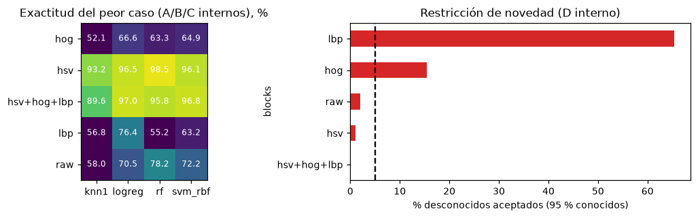

# 6. ML estadístico: identidad del producto

## 6.1 Planteamiento

El enunciado exige que el modelo productivo sea **ML clásico** (extracción de características + modelos
estadísticos); un modelo profundo o generativo solo se admite como referencia comparativa. La identidad se separa
de la pose a propósito: las características que hacen robusta la identidad (casi invariantes al giro, como el
color) destruyen la información del ángulo, y al revés. Por eso hay dos modelos, como en Murase & Nayar (espacio
universal para reconocer y espacio del objeto para la pose).

## 6.2 Características (`src/linevision/features.py`)

| Bloque | Definición | Dimensión | Propiedad |
|---|---|---|---|
| `raw` | Píxeles RGB a 32×32, en [0, 1] | 3.072 | Sensible al giro: entrada del plato y baseline PCA |
| `hsv` | Histograma HSV 16×4×4 sobre el primer plano (máximo de canal > 60), raíz cuadrada (embebido de Hellinger) | 256 | Casi invariante al giro |
| `hog` | HOG sobre gris 64×64, celdas 8×8, bloques 2×2, 9 orientaciones | 1.764 | Forma |
| `lbp` | Histogramas LBP uniformes (P=8, R=1) y (P=16, R=2) sobre gris | 28 | Textura |

Las combinaciones concatenan bloques normalizados L2 por fila para que cada familia pese lo mismo. Costo de
extracción: 2,7–5,3 ms por imagen en CPU para los cuatro bloques (según carga); el sistema final usa solo `hsv` y
`raw` (1,5–1,7 ms por imagen de punta a punta procesando en lote; ≈ 28 ms una imagen suelta, sección 12.6).

## 6.3 Cribado inicial (fase 2, validación interna)

Bloques de más de 150 dimensiones reducidos con PCA(150) ajustada en entrenamiento; hiperparámetros por defecto:
1-NN, regresión logística (C=10), SVM lineal (C=1), SVM-RBF (C=10), Random Forest (500 árboles).

| Representación | Partición | 1-NN | LogReg | SVM lineal | SVM-RBF | RF |
|---|---|---|---|---|---|---|
| PCA50 píxeles | A_in | 98,22 | 97,39 | 95,50 | 98,44 | 97,28 |
| HSV | A_in | 99,61 | 99,50 | 99,33 | 99,89 | 99,72 |
| HOG | A_in | 92,72 | 93,94 | 91,83 | 95,61 | 91,61 |
| LBP | A_in | 73,33 | 89,78 | 82,83 | 87,78 | 80,44 |
| HSV+HOG+LBP | A_in | 99,72 | 99,94 | 99,83 | 100,00 | 99,72 |
| PCA50 píxeles | C_in | 82,33 | 79,33 | 79,00 | 79,67 | 82,33 |
| HSV | C_in | 98,17 | 96,17 | 94,17 | 95,83 | 98,83 |
| HOG | C_in | 63,50 | 66,67 | 62,00 | 64,83 | 63,50 |
| LBP | C_in | 50,00 | 75,50 | 69,67 | 60,67 | 54,50 |
| HSV+HOG+LBP | C_in | 92,17 | 97,50 | 97,00 | 97,67 | 95,17 |
| PCA50 píxeles | B_in | 92,83 | 89,25 | 85,67 | 94,08 | 92,92 |
| HSV | B_in | 98,75 | 99,00 | 98,67 | 98,83 | 99,33 |
| HOG | B_in | 76,25 | 74,25 | 74,25 | 78,83 | 76,00 |
| LBP | B_in | 78,08 | 86,67 | 81,25 | 88,25 | 79,58 |
| HSV+HOG+LBP | B_in | 99,67 | 99,08 | 99,33 | 99,33 | 99,25 |

**Hallazgo central**: entre clasificadores con la misma representación hay 1–3 puntos; entre representaciones,
hasta 30. **La decisión importante es la representación, no el clasificador.**

Rechazo de desconocidos en la misma fase (galería cada 20°, distancia al vecino más cercano):

| Representación | AUROC (aleatorio) | Desconocidos aceptados al 95 % de conocidos (aleatorio) | AUROC (gemelos) | Aceptados (gemelos) |
|---|---|---|---|---|
| PCA50 píxeles | 0,941 | 39,9 % | 0,939 | 48,1 % |
| HSV | 0,920 | 10,0 % | 1,000 | 0,0 % |
| HOG | 0,873 | 66,0 % | 0,924 | 49,1 % |
| HSV+HOG | **0,993** | **3,6 %** | **0,995** | **0,0 %** |

La PCA de píxeles sola dejaba pasar casi la mitad de los desconocidos en esa configuración.

## 6.4 Ajustes de implementación descubiertos al construir (validación interna)

| Cambio | Antes | Después | Motivo |
|---|---|---|---|
| Orden PCA / estandarización | Estandarizar → PCA: clase en A interno 98,7 % | **PCA → estandarizar** | Estandarizar más de 2.000 dimensiones con bins casi vacíos de HSV y HOG amplifica ruido |
| Confianza del SVM | `CalibratedClassifierCV(SVC, cv=3)`: clase interna A 95,2 %, B 96,8 %, **C 75,7 %**, D 99,8 % | **`SoftmaxSVC`**: A 100 %, B 98,8 %, C 96,8 %, D 100 % | Con datos ordenados por (objeto, ángulo), los pliegues sin barajar son sectores ciegos; las sigmoides por clase cambiaban el argmax. Además `SVC(probability=True)` está obsoleto en scikit-learn 1.9 |

La confianza de `SoftmaxSVC` (softmax de las puntuaciones one-vs-rest) resultó escalonada (umbral 0,632–0,633 en
todos los protocolos): por eso la selección también reporta el AURC.

## 6.5 Selección pre-registrada (35 candidatos)

Matriz: 5 representaciones (`raw`, `hsv`, `hog`, `lbp`, `hsv+hog+lbp`) × 7 configuraciones (1-NN; regresión
logística C ∈ {1, 10}; SVM-RBF C ∈ {1, 10, 100}; Random Forest de 500 árboles). Cada candidato se evalúa en 7
ajustes internos (A: 2, B: 3, C: 2).

**Criterio**, escrito en `configs/model.yaml` antes de ejecutar ninguna selección:
1. Restricción de seguridad: en la validación interna de D, **desconocidos aceptados ≤ 5 %** cuando se acepta el 95 %
   de los conocidos (depende solo de la representación).
2. Máxima exactitud del **peor caso** entre A, B y C internos.
3. Empates (diferencias < 0,5 puntos) → menor latencia.

Además se registra el **AURC** (área bajo la curva riesgo-cobertura de la confianza; menor es mejor): mide si la
confianza ordena bien los errores. Cada candidato quedó registrado en MLflow como corrida anidada.

| Candidato | A | B | C | Peor caso | AURC C (%) | Desconocidos aceptados (%) | AUROC novedad |
|---|---|---|---|---|---|---|---|
| **hsv \| rf(500)** | 99,75 | 98,67 | 98,50 | **98,50** | **0,065** | 1,02 | 0,9976 |
| hsv+hog+lbp \| logreg(C=10) | 99,97 | 98,42 | 97,00 | 97,00 | 0,120 | 0,00 | 0,9999 |
| hsv+hog+lbp \| logreg(C=1) | 99,97 | 98,56 | 96,83 | 96,83 | 0,134 | 0,00 | 0,9999 |
| hsv+hog+lbp \| svm_rbf(C=1) | 100,00 | 98,83 | 96,83 | 96,83 | 0,219 | 0,00 | 0,9999 |
| hsv+hog+lbp \| svm_rbf(C=100) | 100,00 | 98,81 | 96,75 | 96,75 | 0,182 | 0,00 | 0,9999 |
| hsv+hog+lbp \| svm_rbf(C=10) | 100,00 | 98,81 | 96,75 | 96,75 | 0,182 | 0,00 | 0,9999 |
| hsv \| logreg(C=1) | 99,53 | 98,06 | 96,50 | 96,50 | 0,348 | 1,02 | 0,9976 |
| hsv \| logreg(C=10) | 99,53 | 97,94 | 96,50 | 96,50 | 0,534 | 1,02 | 0,9976 |
| hsv \| svm_rbf(C=100) | 99,75 | 96,83 | 96,08 | 96,08 | 1,230 | 1,02 | 0,9976 |
| hsv \| svm_rbf(C=10) | 99,81 | 96,86 | 96,08 | 96,08 | 1,230 | 1,02 | 0,9976 |
| hsv+hog+lbp \| rf(500) | 99,81 | 98,50 | 95,83 | 95,83 | 0,320 | 0,00 | 0,9999 |
| hsv \| svm_rbf(C=1) | 99,03 | 96,56 | 95,75 | 95,75 | 1,595 | 1,02 | 0,9976 |
| hsv \| knn1 | 99,14 | 96,58 | 93,17 | 93,17 | 6,243 | 1,02 | 0,9976 |
| hsv+hog+lbp \| knn1 | 99,47 | 95,08 | 89,58 | 89,58 | 9,004 | 0,00 | 0,9999 |
| raw \| rf(500) | 97,11 | 90,19 | 78,17 | 78,17 | 4,638 | 2,04 | 0,9942 |
| lbp \| logreg(C=10) | 90,47 | 83,69 | 76,42 | 76,42 | 9,413 | 65,42 | 0,7996 |
| raw \| svm_rbf(C=10) | 97,39 | 86,97 | 72,25 | 72,25 | 15,652 | 2,04 | 0,9942 |
| raw \| svm_rbf(C=100) | 97,39 | 87,00 | 72,17 | 72,17 | 15,574 | 2,04 | 0,9942 |
| raw \| svm_rbf(C=1) | 96,64 | 86,03 | 72,08 | 72,08 | 25,579 | 2,04 | 0,9942 |
| raw \| logreg(C=1) | 96,17 | 82,53 | 70,50 | 70,50 | 7,081 | 2,04 | 0,9942 |
| raw \| logreg(C=10) | 96,25 | 82,00 | 70,17 | 70,17 | 7,099 | 2,04 | 0,9942 |
| lbp \| logreg(C=1) | 82,67 | 78,17 | 67,58 | 67,58 | 15,257 | 65,42 | 0,7996 |
| hog \| logreg(C=1) | 94,11 | 71,31 | 66,58 | 66,58 | 8,846 | 15,51 | 0,9747 |
| hog \| logreg(C=10) | 94,31 | 70,25 | 66,42 | 66,42 | 8,918 | 15,51 | 0,9747 |
| hog \| svm_rbf(C=1) | 94,53 | 73,78 | 64,92 | 64,92 | 33,262 | 15,51 | 0,9747 |
| hog \| svm_rbf(C=100) | 95,97 | 74,58 | 64,75 | 64,75 | 27,071 | 15,51 | 0,9747 |
| hog \| svm_rbf(C=10) | 95,97 | 74,58 | 64,75 | 64,75 | 27,071 | 15,51 | 0,9747 |
| hog \| rf(500) | 91,56 | 72,36 | 63,33 | 63,33 | 11,374 | 15,51 | 0,9747 |
| lbp \| svm_rbf(C=100) | 91,03 | 88,14 | 63,17 | 63,17 | 37,582 | 65,42 | 0,7996 |
| lbp \| svm_rbf(C=10) | 87,25 | 85,25 | 60,08 | 60,08 | 43,720 | 65,42 | 0,7996 |
| raw \| knn1 (baseline) | 94,17 | 83,36 | 58,00 | 58,00 | 42,932 | 2,04 | 0,9942 |
| lbp \| knn1 | 79,72 | 80,81 | 56,83 | 56,83 | 44,166 | 65,42 | 0,7996 |
| lbp \| rf(500) | 80,31 | 79,00 | 55,17 | 55,17 | 16,204 | 65,42 | 0,7996 |
| hog \| knn1 | 93,11 | 72,56 | 52,08 | 52,08 | 46,527 | 15,51 | 0,9747 |
| lbp \| svm_rbf(C=1) | 61,97 | 65,64 | 46,75 | 46,75 | 61,396 | 65,42 | 0,7996 |

Latencias del clasificador en la ejecución limpia (v1, sin otros procesos): hsv | rf 0,045 ms/img (ajuste 3,3 s);
hsv+hog+lbp | logreg 0,004 ms/img (ajuste 0,08 s); SVM-RBF ≈ 0,34–0,38 ms/img. En la ejecución final las
latencias quedaron infladas porque se ejecutó otra copia del notebook a la vez (sección 10).

### Ganador y lectura

- **Ganador: histograma HSV + Random Forest (500 árboles)**. Mejor peor caso (98,5 %, protocolo C), cumple la
  restricción (1,0 % ≤ 5 %) y tiene el mejor AURC de toda la matriz: su confianza ordena casi perfectamente los errores.
- **La hipótesis previa no se cumplió**: se esperaba que ganara HSV+HOG+LBP. Quedó segunda (97,0 % con regresión
  logística), con 0 % de desconocidos aceptados. Se respetó el criterio pre-registrado.
- Los píxeles con PCA (el baseline) cumplen la restricción de novedad en esta configuración (2,0 %), pero su peor
  caso (58 % con 1-NN; 78 % con RF) los descarta.
- LBP y HOG solos fallan la restricción de novedad (65 % y 16 % de desconocidos aceptados).
- Riesgo documentado: identidad basada en color, sensible a la iluminación. Las pruebas funcionales (sección 9) lo
  confirmaron.

## 6.6 Baseline y referencia moderna

| | Baseline simple | Sistema clásico | Referencia moderna |
|---|---|---|---|
| Identidad | PCA(150) sobre píxeles + 1-NN | HSV + Random Forest | **DINOv2-small** (`facebook/dinov2-small`): [token CLS, media de parches], 768-d, + PCA(150) + regresión logística (C=10) |
| Ángulo | Vista más cercana (1-NN) | Lazo sobre PCA50 de píxeles | Lazo sobre PCA50 de los embeddings DINOv2 |
| Control de seguridad | Ninguno (siempre actúa) | Calibrado en validación interna | El mismo, con la misma calibración |
| Costo de características | Píxeles | 1,5–1,7 ms/img en lote, ≈ 28 ms una imagen suelta; CPU, de punta a punta | 8,6 ms/img en GPU (MPS de Apple); más en CPU |

La referencia usa **el mismo pipeline** que el sistema clásico: así la comparación aísla el efecto de la
representación profunda. Resultados en la sección 8; conclusión: DINOv2 gana 0,4–0,8 puntos de identidad en B y C,
pero pierde en ángulo y en rechazo de desconocidos y exige GPU. **La brecha no justifica su costo.**
