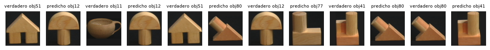
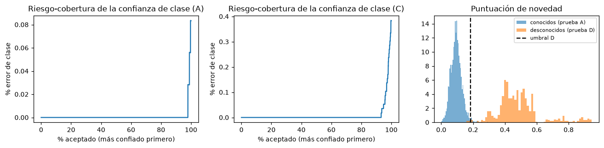

# 8. Resultados

Todas las cifras de esta sección son de **prueba**, evaluada una sola vez por protocolo y repetición, salvo que se
indique lo contrario. Fuente: `reports/results.json` (v2) y `reports/results_v1.json` (v1), generadas por el
notebook; también en MLflow (experimento `reto2-coil100`, etiquetas `iteracion=v1` / `v2`). B y D: media ±
desviación de 3 semillas.

## 8.1 Sistema final (v2), en %

| Protocolo | Clase | Ángulo ±10° (clase dada) | Ídem con simetría | Mediana error | ACT | Ángulo no certificado | Revisión | Desconocido | **Acciones inseguras** | Ángulo ±10° cuando actúa | Desconocidos rechazados |
|---|---|---|---|---|---|---|---|---|---|---|---|
| A | 99,9 | 97,0 | 97,1 | 0,5° | 87,6 | 12,1 | 0,2 | 0,1 | **0,7** | 99,2 | — |
| B | 99,0 ± 0,4 | 55,3 ± 1,6 | 60,9 ± 1,6 | 8,2° ± 0,5 | 0,0 | 93,1 ± 1,8 | 6,1 ± 1,7 | 0,8 ± 0,4 | **0,0** | — | — |
| C | 99,6 | 95,0 | 95,5 | 1,5° | 0,0 | 99,3 | 0,7 | 0,0 | **0,0** | — | — |
| D | — | — | — | — | 0,0 | 0,1 ± 0,2 | 0,0 ± 0,1 | 99,8 ± 0,3 | **0,0** | — | 99,8 ± 0,3 |

"Acción insegura" = el robot actúa (ACT) con la clase equivocada o con el ángulo fuera de ±10°. Latencia de
inferencia (con características ya extraídas): 0,1–0,3 ms por imagen; de punta a punta en producción, imagen →
decisión: 1,5–1,7 ms por imagen en CPU procesando en lote y ≈ 28 ms para una imagen suelta a través del
servicio (el Random Forest de 500 árboles domina; sección 12.6). Para la línea, la cifra relevante es la segunda.

## 8.2 Lectura por protocolo

- **A**: el robot actúa en el 87,6 % y el 99,2 % de esas acciones queda dentro de ±10° (error entre los ACT 0,79 %).
  El objetivo de 99,5 % se cumplió en validación interna (0,47 %) pero no del todo en prueba: la validación interna
  duplica el espaciado entre vistas y no representa exactamente la prueba. Mejora prevista: elegir el umbral con
  una cota superior de confianza del error.
- **B**: la identidad se mantiene (99,0 %). Con una sola imagen el ángulo en el arco acierta el 55 % (baseline
  28 %), así que **por política el robot no actúa** sobre SKUs sin cobertura. Con 2a captura (8.4) se recupera.
- **C**: clase 99,6 % y ángulo 95,0 %, pero el sistema **no se auto-certifica** con 12 vistas (la validación
  interna con huecos de 60° no puede demostrar el criterio) y no actúa. Es seguro y conservador; coherente con
  exigir una galería más densa al dar de alta un SKU.
- **D**: 99,8 % de los objetos nuevos rechazados como desconocidos y 0 % de acciones inseguras.

## 8.3 Comparación con baseline y referencia moderna (v2), en %

| Protocolo | Modelo | Clase | Ángulo ±10° (clase dada) | **Acciones inseguras** | Desconocidos rechazados |
|---|---|---|---|---|---|
| A | baseline PCA + 1-NN | 99,8 | 96,1 | 4,1 | — |
| A | **clásico HSV + RF** | 99,9 | **97,0** | 0,7 | — |
| A | referencia DINOv2 | 100,0 | 95,3 | 0,4 | — |
| B | baseline | 84,2 ± 0,8 | 28,2 ± 0,1 | 72,7 ± 0,1 | — |
| B | **clásico** | 99,0 ± 0,4 | **55,3 ± 1,6** | 0,0 | — |
| B | DINOv2 | 99,8 ± 0,3 | 21,8 ± 0,3 | 0,0 | — |
| C | baseline | 94,2 | 74,1 | 28,3 | — |
| C | **clásico** | 99,6 | **95,0** | 0,0 | — |
| C | DINOv2 | 100,0 | 87,7 | 0,0 | — |
| D | baseline | — | — | 100,0 | 0,0 |
| D | **clásico** | — | — | 0,0 | **99,8 ± 0,3** |
| D | DINOv2 | — | — | 0,0 ± 0,1 | 93,1 ± 2,7 |

Costo: clásico 1,5–1,7 ms/img de punta a punta en CPU en lote (≈ 28 ms una imagen suelta); DINOv2 8,6 ms/img solo el embedding,
en la GPU de un Mac (MPS), con un modelo de ~22 M de parámetros.

**¿Justifica la brecha su costo?** No. DINOv2 mejora la identidad 0,4–0,8 puntos en B y C, pero empeora el ángulo
(B: 21,8 % frente a 55,3 %; C: 87,7 % frente a 95,0 %) y el rechazo de desconocidos (93,1 % frente a 99,8 %), y exige
GPU. El sistema clásico es mejor en las métricas que determinan la seguridad del agarre.

## 8.4 Sector ciego con 2a captura (B, Δ = 180°)

| Semilla | Ángulo ±10° (todos) | El robot actúa | ±10° cuando actúa | Acciones inseguras | Error medio cuando actúa |
|---|---|---|---|---|---|
| 2026 | 96,75 % | 94,25 % | 98,94 % | 1,00 % | 1,47° |
| 2027 | 97,67 % | 93,33 % | 99,46 % | 0,50 % | 1,41° |
| 2028 | 97,67 % | 94,00 % | 99,29 % | 0,67 % | 1,54° |
| **Media** | **97,4 %** | **93,9 %** | 99,2 % | **0,72 %** | 1,47° |

En v1 la misma 2a captura acertaba igual (96,75–97,67 %) pero solo actuaba en el 5,7–9,5 % por la temperatura mal
calibrada (sección 7.5).

## 8.5 v1 frente a v2

| Protocolo | Métrica | v1 | v2 |
|---|---|---|---|
| A | ACT / acciones inseguras / ±10° cuando actúa | 87,9 % / **1,0 %** / 98,8 % | 87,6 % / **0,7 %** / 99,2 % |
| B | ACT / inseguras | 0 % / 0 % | 0 % / 0 % |
| C | ACT / inseguras / ±10° cuando actúa | 10,4 % / 0,2 % / 98,1 % | 0 % / 0 % / — |
| D | inseguras / desconocidos rechazados | 0,1 ± 0,2 % / 99,8 % | 0,0 % / 99,8 % |
| B con 2a captura | actúa / inseguras | 5,7–9,5 % / 0–0,17 % | 93,3–94,3 % / 0,5–1,0 % |
| DINOv2 en D | inseguras | 6,7 ± 2,4 % | 0,0 ± 0,1 % |
| DINOv2 en A | inseguras | 1,2 % | 0,4 % |

La identidad, el ángulo con clase dada y la selección no cambian entre iteraciones: la v2 solo cambia el control
de seguridad y la calibración de la incertidumbre.

## 8.6 Análisis de errores

**Confusiones de clase en C** (verdadero → predicho, número de imágenes): 51→12 (7), 11→12 (4), 51→80 (3), 12→77 (2),
41→80 (2), 80→41 (2), 9→97 (1), 51→41 (1). Son piezas de madera y objetos del mismo tono.

**Objetos con mayor error de ángulo en A** (clase dada): obj95 (error medio 13,8°, 58 % dentro de ±10°), obj50
(12,8°, 69 %), obj47 (7,1°, 67 %), obj25 (6,6°), obj94 (6,6°), obj18 (6,4°), obj34 (6,0°), obj83 (5,9°). Ninguno con
giros de más de 150°. Objetos con simetría de orden 2 estimada sin mirar la prueba: **1, 12, 31, 33, 65, 66, 67, 79,
84, 98**.

**Sector ciego (B, semilla 2026)**: decisiones en el arco: ANGLE_UNCERTIFIED 94,2 %, REVIEW 4,6 %, UNKNOWN 1,3 %. El
ángulo de una sola imagen (clase dada) cae dentro de ±10° en el 53,8 % y el 17,7 % de los errores supera 90°.

**Confianza y novedad**:

