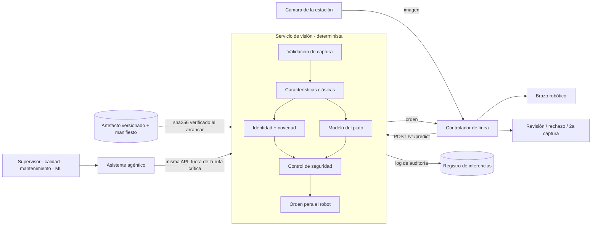
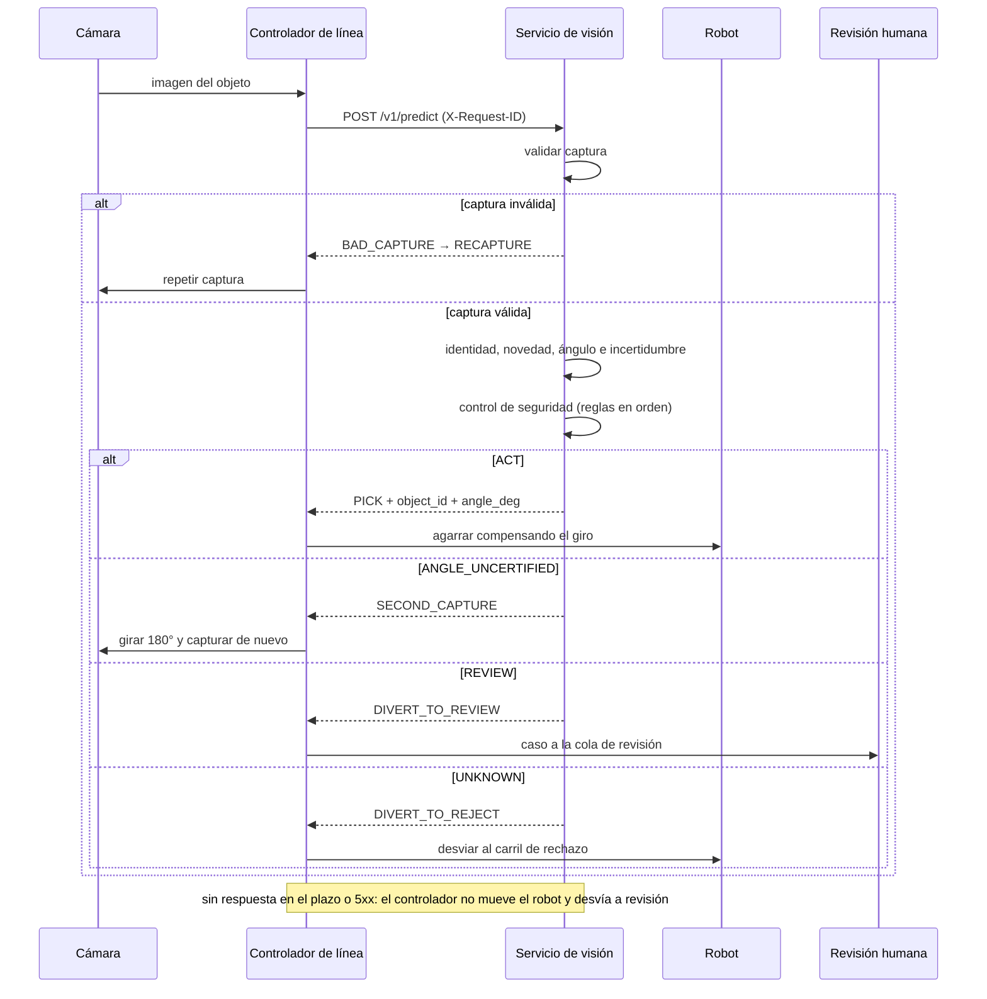

# 12. Servicio de visión (Reto 4)

API HTTP propia del modelo del Reto 2, independiente del asistente agéntico. Es la única pieza en la ruta
crítica imagen → robot y es determinista: no llama a ningún LLM.

Código: `src/linevision/service/`. Contrato OpenAPI: [`openapi/vision.json`](openapi/vision.json) (generado
desde el código; también en `/docs` y `/openapi.json` con el servicio arrancado).

## 12.1 Ejecución con un solo comando

```bash
# local (probado en Windows con Python 3.12)
uv run --extra service linevision-serve

# contenedor
docker compose up --build
```

El servicio queda en `http://127.0.0.1:8001`. La imagen Docker y `compose.yaml` están escritos pero **no se han
probado**: el equipo de desarrollo no tiene Docker instalado.

```bash
curl -F "images=@coil-100/obj5__40.png" "http://127.0.0.1:8001/v1/predict?top_k=3"
```

## 12.2 Endpoints

| Método y ruta | Qué hace |
|---|---|
| `GET /healthz` | Proceso vivo |
| `GET /readyz` | Modelo cargado y verificado; 503 mientras carga |
| `GET /v1/model` | Versión, versión de datos, sha256, umbrales del control de seguridad y métricas de calibración |
| `GET /v1/catalog` | SKUs del catálogo: vistas de referencia, hueco angular máximo, certificación de ángulo, simetría |
| `GET /v1/reference/{object_id}/{angle_deg}` | Vista de referencia en PNG (evidencia) |
| `POST /v1/predict` | Una o varias imágenes → decisión, orden para el robot, calidad, identidad, ángulo y top-k |
| `GET`/`POST /admin/fault` | Solo con `VISION_FAULT_INJECTION=true`: simula 5xx o timeouts en las siguientes inferencias |

Todos los errores tienen el mismo cuerpo: `{"code", "message", "request_id"}`. Códigos: `unauthorized` (401),
`reference_not_found` / `reference_unavailable` (404), `batch_too_large` / `image_too_large` (413), validación
de parámetros (422) y `service_unavailable` (503).

## 12.3 Qué recibe el robot

Tabla fija en `service/robot.py`. El robot solo recibe un ángulo con `PICK`.

| Decisión | Origen | Orden al robot | Qué pasa en la línea |
|---|---|---|---|
| `ACT` | control de seguridad | `PICK` + `object_id` + `angle_deg` | Agarre compensando el giro |
| `ANGLE_UNCERTIFIED` | control de seguridad | `SECOND_CAPTURE` | Giro de 180° o 2a cámara y nueva estimación; si persiste, alineación manual |
| `REVIEW` | control de seguridad | `DIVERT_TO_REVIEW` | Cola de revisión humana |
| `UNKNOWN` | control de seguridad | `DIVERT_TO_REJECT` | Carril de rechazo |
| `BAD_CAPTURE` | validación de captura | `RECAPTURE` | Se repite la captura; el modelo no llega a ejecutarse |

## 12.4 Validación de captura

Antes de inferir (`service/quality.py`), con criterios objetivos: archivo decodificable, lado mínimo de 32 px,
relación de aspecto ≤ 1,5, y fracción de primer plano entre 2 % y 98 % (imagen vacía o sin fondo oscuro). Si
falla, la respuesta es `BAD_CAPTURE` con los motivos. Las imágenes de otro tamaño se reescalan a 128×128.

Limitación conocida: no hay segmentación ni centrado del objeto. Un objeto desplazado pasa esta validación y
puede producir un ángulo erróneo (sección 9.3).

## 12.5 Controles

- **Integridad del modelo**: al arrancar se compara el sha256 del artefacto con su manifiesto; si no coincide,
  el servicio no arranca.
- **Autenticación**: si `VISION_API_KEY` está definida se exige la cabecera `X-API-Key` (salvo en `/healthz` y
  `/readyz`).
- **Límites**: 5 MB por imagen y 16 imágenes por petición, configurables.
- **Trazabilidad**: cada petición lleva `X-Request-ID` (se respeta el del cliente si es válido). Por cada imagen
  se registra una línea JSON con el identificador, el sha256 de la imagen, la versión del modelo, la decisión y
  la orden al robot. El contenido de la imagen no se registra.
- **Inyección de fallos**: desactivada por defecto; solo para la demo de robustez del asistente.

## 12.6 Latencia medida

En un portátil con Windows, CPU, una imagen por petición, 30 repeticiones tras calentar:

| Medida | Mediana | p95 |
|---|---|---|
| Servidor (decodificar → respuesta) | 27,7 ms | 29,3 ms |
| Cliente HTTP local | 30,3 ms | 32,3 ms |

Desglose de una imagen: características 1,5 ms, identidad 24,2 ms, vecinos 0,4 ms, pose 0,3 ms. El Random
Forest de 500 árboles domina cuando se predice una sola imagen. En lotes de 64 el costo baja a 2,1 ms por
imagen, que es el orden de las cifras de 1,5–1,7 ms de la sección 8: esas eran por imagen en lote, no por
petición. Para una línea que procesa un objeto a la vez, la cifra relevante es ~28 ms.

## 12.7 Arquitectura



El asistente es un cliente más de la API. Si el asistente o el LLM fallan, la línea sigue operando.

## 12.8 Secuencia: imagen → robot


