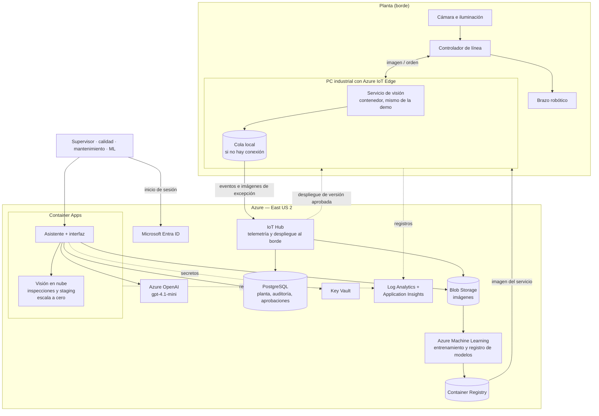

# 16. Arquitectura en Azure y FinOps (Reto 6)

Diseño de la arquitectura objetivo en Azure y su modelo de costos. **Es un diseño: no está desplegado.** La demo
corre en local (secciones 12 y 14). Hoja de cálculo: [`costos/modelo_de_costos_azure.xlsx`](costos/modelo_de_costos_azure.xlsx).
Precios: [`costos/precios_azure_eastus2_2026-10-10.json`](costos/precios_azure_eastus2_2026-10-10.json), tomados de la
API pública de precios de Azure el 2026-10-10 (lista, pago por uso, región East US 2, sin impuestos ni descuentos).

## 16.1 La decisión que ordena todo: qué va en la planta y qué va en la nube

El enunciado pide decidir "dónde se ubica cada parte respecto a la operación de la línea, justificando la decisión
con criterios de latencia, costo y riesgo".

| Parte | Dónde | Latencia | Costo | Riesgo |
|---|---|---|---|---|
| **Inferencia de la línea** (imagen → orden al robot) | **En la planta**, en un PC junto a la estación | ~28 ms medidos, sin red de por medio | Equipo propio; el modelo corre en CPU | La línea no puede depender de internet: si se cae el enlace, sigue operando |
| **Asistente** | Nube | Segundos; lo usa una persona | Paga por uso | Si cae, la línea no se entera |
| **Entrenamiento, registro de modelos, datos históricos** | Nube | No aplica | Paga por horas de cómputo | Sin impacto en la operación |
| **Telemetría de la línea** | De la planta a la nube, con almacenamiento local si no hay conexión | Minutos de retraso aceptables | Bajo | La pérdida de conexión no pierde datos |

**Alternativa descartada: inferencia en la nube.** Sería más simple de operar (un solo sitio, sin equipo en planta),
y el costo de cómputo sería irrelevante a este volumen. Se descarta por riesgo y latencia: cada objeto dependería
del enlace de la planta, y a la latencia del modelo se sumaría un viaje de ida y vuelta a un centro de datos en
otro país, variable e imposible de garantizar. No he medido esa latencia desde la planta; habría que hacerlo antes
de reconsiderar esta decisión.

**Lo que cuesta esta decisión:** hay equipo físico que comprar, mantener y actualizar en cada estación. Lo resuelve
Azure IoT Edge, que despliega el contenedor del servicio de visión en el PC de la planta y lo actualiza desde la
nube.

## 16.2 Diagrama de arquitectura

El contenedor del servicio de visión es **el mismo** en la planta y en la nube. En la planta atiende la línea; en la
nube atiende las inspecciones manuales del asistente y la validación de productos nuevos en staging, sin tocar la
línea.

## 16.3 Servicios, por qué cada uno y qué se descartó

| Necesidad | Servicio elegido | Por qué | Alternativa y trade-off |
|---|---|---|---|
| Ejecutar el modelo junto a la línea | **Azure IoT Edge** sobre un PC industrial | Despliega y actualiza contenedores desde la nube, funciona sin conexión y guarda los mensajes hasta recuperarla. El runtime no tiene costo | *Kubernetes con Azure Arc*: más potente y estándar, pero es operar un clúster por estación para un solo contenedor. *Instalación manual*: sin costo de servicio, pero sin trazabilidad de qué versión corre en cada línea |
| Recibir telemetría y gobernar los equipos | **IoT Hub (S1)** | Identidad por dispositivo, comunicación en los dos sentidos y es el requisito de IoT Edge | *Event Hubs*: más barato por evento (0,028 USD por millón), pero solo recibe: no despliega ni gestiona dispositivos. Es la partida fija más cara del diseño (25 USD/mes) y se acepta por lo que evita construir |
| Ejecutar el asistente y la visión en nube | **Container Apps** | Ejecuta los contenedores que ya existen, escala a cero y cobra por segundo. Sin clúster que administrar | *AKS*: control total, pero costo fijo y operación desproporcionados para dos contenedores. *App Service*: válido; pierde el escalado a cero. *Functions*: obligaría a reescribir el servicio |
| Modelo de lenguaje | **Azure OpenAI, gpt-4.1-mini** | Los datos se quedan en la suscripción del cliente, con identidad administrada. El cambio desde Gemini es una clase nueva tras la interfaz de `llm.py` | *gpt-4.1-nano*: cuatro veces más barato, pero habría que repetir la evaluación del agente. *Despliegue en zona de datos*: 10 % más caro a cambio de residencia de datos. **El proveedor Azure OpenAI no está implementado en el repositorio** |
| Estado de planta, auditoría, aprobaciones | **PostgreSQL servidor flexible (B1ms)** | Relacional, transacciones para las aprobaciones, seguridad a nivel de fila para aislar plantas. La demo usa SQLite con el mismo esquema | *Cosmos DB*: escala global que aquí no hace falta, y las consultas de agregación por turno son naturales en SQL. *Azure SQL*: equivalente; PostgreSQL evita licencias y es lo más cercano a la demo |
| Imágenes | **Blob Storage (Hot, LRS)** con reglas de ciclo de vida | Barato y con caducidad automática: las cargas del asistente se borran a las 72 h; las de excepción, a los 3 meses | *Nivel Cool*: más barato por GB pero cobra por lectura; conviene para el dataset de reentrenamiento histórico |
| Entrenar y versionar modelos | **Azure Machine Learning** | Compatible con MLflow, que ya usa el proyecto: los experimentos y el registro migran sin reescribir. El clúster escala a cero | *Entrenar en un PC*: es lo que se hizo en la prueba; no deja rastro compartido ni control de quién promueve qué |
| Imágenes de contenedor | **Container Registry (Basic)** | Privado, integrado con IoT Edge y Container Apps | Registro público: inaceptable para el modelo de un cliente |
| Identidad | **Microsoft Entra ID** | Sustituye el inicio de sesión de la demo. Roles y líneas salen de grupos; el resto del sistema ya trabaja con un `Principal` | Usuarios propios en la base: más trabajo y peor seguridad |
| Secretos | **Key Vault** + identidades administradas | Ninguna clave en código ni en variables de entorno | `.env`: solo válido para la demo |
| Observabilidad | **Log Analytics + Application Insights** | Trazas del asistente, registros de inferencia y alertas en un solo sitio | Sin alternativa razonable dentro de Azure a esta escala |

### Lo que se deja fuera a propósito

| Servicio | Costo | Por qué no ahora | Cuándo sí |
|---|---|---|---|
| **Azure AI Search** (Basic) | 73,73 USD/mes | Casi duplicaría la factura para buscar en 6 procedimientos; la búsqueda léxica en proceso basta | Cientos de documentos, búsqueda semántica o permisos por documento |
| **API Management** (Basic v2) | 150 USD/mes | Costaría el doble que todo lo demás junto | Varias plantas, cuotas por usuario o exposición a terceros |
| **GPU** | — | El modelo es clásico y corre en CPU. Es una consecuencia directa de la conclusión del Reto 2 | Solo si se adoptara la referencia profunda |

## 16.4 Flujos principales

**Imagen → robot (ruta crítica).** Cámara → controlador → servicio de visión en el PC de la planta → orden al robot.
Nada sale de la planta. El evento de inferencia se guarda en la cola local y viaja a IoT Hub cuando hay conexión.

**Excepción.** Si la decisión no es ACT, la imagen sube a Blob Storage y el caso queda en PostgreSQL. El asistente lo
muestra en la cola de revisión.

**Petición al asistente.** Usuario → Entra ID → asistente → Azure OpenAI y tools → PostgreSQL, Blob y visión en nube.

**Promoción de un modelo.** Entrenamiento en Azure ML → modelo registrado → imagen en Container Registry →
validación en la visión de nube (staging) → solicitud y aprobación humana en el asistente → IoT Hub despliega la
versión al borde. La línea nunca recibe un modelo que no haya pasado por una aprobación.

## 16.5 Seguridad y aislamiento

- **Identidad**: Entra ID para personas; identidades administradas entre servicios; una identidad por dispositivo
  en IoT Hub.
- **Aislamiento entre plantas**: seguridad a nivel de fila en PostgreSQL por planta, contenedores de Blob por planta
  y un dispositivo de IoT Hub por estación. El asistente ya filtra todo por la planta de la sesión.
- **Datos enviados al modelo de lenguaje**: texto de la conversación y resultados de tools. Nunca imágenes.
- **Red**: el diseño base usa puntos de conexión públicos con autenticación. Una versión endurecida añade red
  virtual y puntos de conexión privados; **no está en el modelo de costos**.
- **Integridad del modelo**: el servicio ya comprueba la huella del artefacto al arrancar.

## 16.6 Disponibilidad

| Fallo | Qué pasa | Por qué |
|---|---|---|
| Se cae internet en la planta | La línea sigue; la telemetría se acumula y sube después | La inferencia es local |
| Se cae Azure OpenAI o el asistente | La línea sigue; no hay asistente | Están fuera de la ruta crítica |
| Falla el PC de la estación | **La línea se detiene** | Es el punto único de fallo |

El último es el riesgo real del diseño. Mitigación: un PC de repuesto por planta preparado para recibir el despliegue
desde IoT Hub, y el procedimiento manual como respaldo. Un segundo PC en caliente por estación duplicaría el costo
de equipo; con el valor de una hora de línea parada se puede decidir, y ese dato no lo tengo.

La nube queda en una sola región. La base tiene copias de seguridad; no hay réplica en otra región porque nada de
lo que corre en la nube detiene la producción.

## 16.7 Región

Se eligió **East US 2** por precio y disponibilidad de modelos. La alternativa natural para una planta en Colombia
es **Brazil South**, más cercana:

| | East US 2 | Brazil South |
|---|---|---|
| PostgreSQL B1ms | 0,017 USD/h | 0,035 USD/h (el doble) |
| Container Apps | Mismo precio | Mismo precio |
| Azure OpenAI gpt-4.1-mini (global) | Mismo precio | Mismo precio |

Como la inferencia es local, la latencia a la nube solo afecta al asistente, donde unos milisegundos no importan.
Brazil South solo se justificaría por una exigencia de residencia de datos.

## 16.8 Modelo de costos

Caso base: **2 líneas**, un objeto cada 30 s, 24 h × 5 días (62.400 objetos por línea y mes), 6 usuarios del
asistente por línea con 8 peticiones al día. Todas las cifras salen de la hoja de cálculo, donde cada supuesto es
una celda editable.

### Costo mensual en Azure

| Componente | Servicio | Fijo | Variable por línea | Total (2 líneas) |
|---|---|---|---|---|
| Telemetría y despliegue al borde | IoT Hub S1 | 25,00 | — | 25,00 |
| Estado de planta, auditoría, aprobaciones | PostgreSQL B1ms | 16,09 | — | 16,09 |
| Asistente, siempre encendido | Container Apps | 11,83 | 0,03 | 11,89 |
| Registros y monitoreo | Log Analytics | — | 4,14 | 8,28 |
| Modelo de lenguaje | Azure OpenAI | — | 3,11 | 6,23 |
| Registro de contenedores | Container Registry | 6,07 | — | 6,07 |
| Entrenamiento | Azure ML (cómputo) | 1,92 | — | 1,92 |
| Secretos | Key Vault | 0,30 | — | 0,30 |
| Imágenes | Blob Storage | — | 0,13 | 0,27 |
| Visión en nube | Container Apps, escala a cero | — | 0,03 | 0,06 |
| **Total Azure** | | **61,20** | **7,45** | **76,10 USD/mes** |

### Lo que dice esta tabla

1. **La nube es barata porque el modelo es clásico.** No hay GPU, y la inferencia pesada ni siquiera corre en la
   nube. Es la consecuencia económica de la conclusión del Reto 2.
2. **El 80 % es costo fijo** (61 de 76 USD). Añadir una línea cuesta 7,45 USD al mes en Azure.
3. **El modelo de lenguaje no es el problema**: 6 USD al mes. Cada petición cuesta unos 0,003 USD con el consumo
   medido en la evaluación (6.783 tokens de entrada y 176 de salida).
4. **La partida más grande es IoT Hub**, y se paga por capacidad que no se usa: dos líneas generan unos 5.800
   mensajes al día.

### Equipo en planta (no es Azure)

PC industrial, cámara e iluminación: 3.000 USD por estación (supuesto), amortizados en 36 meses más mantenimiento:
**108 USD por línea y mes**. Cuesta más que toda la nube.

### Caso de negocio

| Concepto | USD/mes (2 líneas) |
|---|---|
| **Operación actual**: 6 operarios (2 líneas × 3 turnos) | **3.600** |
| Azure | 76 |
| Equipo en planta | 217 |
| Personal para excepciones (0,25 persona por turno y línea) | 900 |
| Ingeniería de ML y soporte (0,2 persona) | 500 |
| **Operación automatizada** | **1.693** |
| **Ahorro mensual** | **1.907 (53 %)** |
| Inversión única del proyecto | 40.000 |
| Meses para recuperar la inversión | 21 |

Indicadores unitarios: Azure cuesta **0,61 USD por cada 1.000 objetos**; la operación automatizada completa, 13,56;
la actual, 28,85. **Azure es el 4 % del costo recurrente**: lo que decide el caso de negocio son las personas.

### Advertencia sobre el caso de negocio

Depende de supuestos míos que el enunciado no da y que están marcados en amarillo en la hoja:

- **Costo del operario** (600 USD al mes cargado): hay que sustituirlo por el dato real.
- **Personal para excepciones**: con un 12 % de objetos que no son ACT, alguien tiene que atenderlos. No se elimina
  a las seis personas; se supone que queda un cuarto de jornada por turno y línea.
- **Inversión del proyecto** (40.000 USD).
- **Velocidad de línea** (30 s por objeto): es la de la planta simulada.

Con estos supuestos el ahorro existe pero no es espectacular, y el plazo de recuperación es de casi dos años con dos
líneas. No lo presentaría como más de lo que es.

### Cómo escala

| Líneas | Azure | Azure por línea | Total automatizado | Operación actual | Ahorro mensual | Meses para recuperar |
|---|---|---|---|---|---|---|
| 1 | 69 | 69 | 1.127 | 1.800 | 673 | 59 |
| 2 | 76 | 38 | 1.693 | 3.600 | 1.907 | 21 |
| 5 | 98 | 20 | 3.390 | 9.000 | 5.610 | 7 |
| 10 | 136 | 14 | 6.219 | 18.000 | 11.781 | 3,4 |
| 20 | 210 | 11 | 11.877 | 36.000 | 24.123 | 1,7 |

**Con una sola línea el proyecto no se paga** en un plazo razonable; a partir de cinco, sí. La tabla mantiene
constantes la inversión y la dedicación de ingeniería, que en la práctica crecerían algo con el número de líneas.

## 16.9 FinOps: cómo se gobierna el costo

**Visibilidad.** Etiquetas obligatorias en cada recurso (`planta`, `linea`, `entorno`, `componente`), presupuesto
mensual con alertas al 80 % y al 100 %, y el indicador que importa al negocio: costo por cada 1.000 objetos.

**Palancas, ordenadas por efecto:**

| Palanca | Efecto estimado | Costo o riesgo |
|---|---|---|
| Caché de las instrucciones y contratos de tools del asistente | LLM de 6,23 a 4,11 USD/mes con la mitad de la entrada en caché | Ninguno; es configuración |
| Sustituir IoT Hub por Event Hubs + despliegue por otro medio | Hasta 25 USD/mes, la mayor partida | Se pierde la gestión de dispositivos: no compensa |
| Modelo de lenguaje más pequeño (gpt-4.1-nano) | LLM de 6,23 a 1,56 USD/mes | Hay que repetir la evaluación del agente; puede bajar la calidad |
| Apagar el asistente fuera de uso (escala a cero) | Hasta 11,83 USD/mes | Arranque en frío de varios segundos en la primera petición |
| Reserva de PostgreSQL a 1 o 3 años | Descuento sobre 16 USD/mes | Compromiso; no he consultado el precio de reserva |
| Ciclo de vida en Blob y muestreo de imágenes | Marginal hoy | Crece si la cámara es de alta resolución |
| Límite diario de ingesta en Log Analytics | Evita sorpresas | Los registros son lo que más puede crecer sin que nadie lo decida |

**La conclusión de FinOps es que aquí la nube no es donde está el dinero.** Optimizar los 76 USD tiene poco
recorrido. Lo que mueve el caso de negocio es reducir las excepciones (cada punto de ACT que se gana es menos
personal de revisión) y el número de líneas sobre las que se reparte la inversión.

**Riesgos de costo a vigilar:** un loop del agente (ya acotado: 60.000 tokens por turno), un aumento de registros
al activar trazas detalladas, y guardar todas las imágenes en lugar de una muestra.

## 16.10 Equivalencia en AWS

El índice del enunciado menciona "Azure vs AWS"; el cuerpo pide solo Azure. Se incluye la correspondencia como
referencia, **sin precios**: no los he consultado.

| Función | Azure | AWS |
|---|---|---|
| Contenedores en el borde | IoT Edge | IoT Greengrass |
| Telemetría y dispositivos | IoT Hub | IoT Core |
| Contenedores sin servidor | Container Apps | App Runner / ECS Fargate |
| Modelo de lenguaje | Azure OpenAI | Bedrock |
| Base relacional | PostgreSQL servidor flexible | RDS for PostgreSQL |
| Objetos | Blob Storage | S3 |
| Entrenamiento y registro | Azure Machine Learning | SageMaker |
| Identidad | Entra ID | IAM Identity Center |
| Secretos | Key Vault | Secrets Manager |
| Observabilidad | Azure Monitor | CloudWatch |

La arquitectura es la misma en las dos nubes: la decisión de fondo (inferencia en la planta, asistente en la nube)
no depende del proveedor. Lo que suele decidir es dónde tiene ya el cliente su identidad corporativa y sus contratos.

## 16.11 Limitaciones de este diseño

- **No está desplegado ni probado en Azure.** Es un diseño con precios reales, no una medición.
- **Precios de lista** de una región, sin impuestos, sin descuentos por reserva ni acuerdos del cliente.
- **Dos precios no se pudieron verificar en la API** y están marcados: el almacenamiento de PostgreSQL y los puntos
  de conexión privados.
- **Tres datos provienen de la documentación de Azure y no los verifiqué hoy**: la capacidad diaria de una unidad S1
  de IoT Hub, que IoT Edge exija el nivel estándar, y la franquicia gratuita de Container Apps (que el modelo no
  descuenta, así que es conservador).
- **No se modeló**: red privada, soporte de Azure, tráfico de salida, impuestos ni el costo de migrar SQLite a
  PostgreSQL.
- **La latencia desde la planta a la nube no se midió.**
- **El uso del asistente es un supuesto**; el consumo por petición sí está medido.
