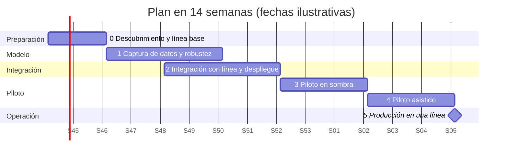

# 17. Plan de proyecto

Cómo llevar a producción lo construido en esta prueba, con un equipo pequeño. La prueba deja un prototipo
funcional sobre datos de laboratorio; este plan cubre lo que falta para que funcione en una planta y a quién le
toca cada cosa.

Los plazos, el tamaño del equipo y el presupuesto son **una propuesta mía**: el enunciado no los fija. Se ajustan con
el cliente en la fase 0.

## 17.1 Objetivo y criterios de éxito

**Objetivo**: sustituir la identificación y alineación manual por el sistema de visión en una línea, sin perder
ritmo ni calidad, con un mecanismo seguro para lo que el sistema no resuelve.

El proyecto se da por bueno si, en la línea piloto y durante cuatro semanas seguidas, se cumple todo esto:

| Criterio | Umbral | De dónde sale |
|---|---|---|
| Acciones inseguras entre las veces que el robot actúa | ≤ 0,5 % | Traducción de la tolerancia de ±10° (documento 7) |
| Objetos que el robot atiende sin intervención | ≥ 85 % | En laboratorio se midió 87,6 % |
| Ritmo de la línea | Igual o mejor que con el operario | Línea base medida en la fase 0 |
| Paradas atribuibles al sistema | Las que acepte operación; a fijar en la fase 0 | No tengo el dato de partida |
| Excepciones resueltas dentro del turno | 100 % | Procedimiento SOP-QA-003 |

Los dos primeros umbrales ya tienen medición en laboratorio. Los otros dos necesitan la línea base de la planta.

## 17.2 Punto de partida

| Ya existe (esta prueba) | Falta para una planta |
|---|---|
| Modelo de identidad y ángulo con control de seguridad | Que aguante luz variable y objetos descentrados |
| Servicio de visión con API, en contenedor | Integración con el controlador de línea y el robot |
| Asistente con 22 tools, permisos y aprobaciones | Datos reales en lugar de la planta simulada; identidad corporativa |
| Evaluación reproducible del modelo y del agente | Evaluación con imágenes de la propia planta |
| Diseño de arquitectura y costos en Azure | Desplegarlo |

Lo más importante de la columna derecha es la primera fila: las pruebas de robustez (documento 9) mostraron que el
modelo falla con un objeto desplazado (10,5 % de acciones inseguras) y rechaza producto conocido si cambia la luz.
**El plan empieza por ahí, no por desplegar.**

## 17.3 Equipo

Cuatro personas, dos de ellas a tiempo parcial.

| Rol | Dedicación | Responsabilidad |
|---|---|---|
| **Líder técnico / ingeniería de ML** (mi rol) | 100 % | Modelo, criterios de aceptación, decisiones técnicas, interlocución con negocio y operación |
| **Ingeniería de software y plataforma** | 100 % | Servicio en el borde, despliegue en Azure, asistente, observabilidad |
| **Ingeniería de automatización** | 50 % | Cámara, iluminación, integración con el controlador y el robot |
| **Referente de planta** (supervisor o calidad) | 20 % | Define qué es aceptable, valida procedimientos, lidera el cambio con los operarios |

Con el patrocinio de un responsable de planta que decide en cada puerta de fase.

**Cómo se trabaja**

- Ciclos de dos semanas con una demostración en la planta al final de cada uno.
- Un tablero único con el trabajo pendiente, visible para la planta.
- Registro de decisiones: cada decisión técnica con sus alternativas y su motivo, como el de esta prueba.
- "Terminado" significa: con pruebas automáticas, medido contra el criterio de aceptación y documentado.
- Nada llega a la línea sin aprobación explícita del referente de planta. Es la misma regla que aplica el asistente.

## 17.4 Fases

Las fases 1 y 2 se solapan dos semanas: la integración puede avanzar con el modelo actual mientras se mejora.

### Fase 0 — Descubrimiento y línea base (2 semanas)

- Medir la operación actual: ritmo, errores del operario, paradas, costo. Sin esto no hay con qué comparar.
- Inventario de productos y sus variantes; cuáles son simétricos.
- Condiciones reales: iluminación, posición en que llegan los objetos, cámara posible.
- Confirmar con operación la tolerancia de agarre (±10° es un supuesto del enunciado) y el riesgo aceptable.

**Puerta de salida**: línea base firmada por operación; lista de productos del piloto; criterios de éxito acordados.

### Fase 1 — Captura de datos y robustez (4 semanas)

- Estación de captura con la cámara y la iluminación definitivas; galería de referencia de cada producto (72 vistas,
  o 36 como mínimo).
- Las cuatro mejoras ya diagnosticadas: localizar y centrar el objeto antes de analizarlo, igualar el brillo, regla
  para objetos volcados, y robustez en el criterio de selección del modelo.
- Recalibrar todos los límites del control de seguridad con imágenes de la planta.
- Repetir las pruebas de robustez, ahora con variaciones reales y no simuladas.

**Puerta de salida**: en un conjunto reservado de imágenes de la planta, acciones inseguras ≤ 0,5 % y el robot actúa
en ≥ 85 % de los casos. **Si no se alcanza, el proyecto no pasa a piloto.**

### Fase 2 — Integración con la línea y despliegue (4 semanas)

- Conectar el servicio de visión con el controlador de línea y el robot; definir qué hace el robot ante cada orden.
- Carril físico para excepciones: revisión, rechazo y segunda captura.
- Despliegue en Azure según el documento 16; PC en la estación con IoT Edge.
- Asistente conectado a datos reales y a la identidad corporativa.
- Pruebas de fallo: sin red, PC apagado, servicio caído.

**Puerta de salida**: la línea funciona de punta a punta en un turno de prueba sin producción real; el procedimiento
manual de respaldo está probado.

### Fase 3 — Piloto en sombra (3 semanas)

El sistema ve cada objeto y registra lo que haría, pero **el operario sigue haciendo el trabajo**. Riesgo cero para
la producción.

- Comparar cada decisión del sistema con lo que hizo el operario.
- Ajustar umbrales con datos de operación real.
- Los operarios y supervisores empiezan a usar el asistente.

**Puerta de salida**: los criterios de éxito se cumplen en sombra durante dos semanas seguidas.

### Fase 4 — Piloto asistido (3 semanas)

El sistema actúa y el operario supervisa y atiende las excepciones. Se empieza por un turno y se amplía.

**Puerta de salida**: criterios de éxito cumplidos cuatro semanas (contando las de sombra); operación acepta el
traspaso.

### Fase 5 — Producción y escalado

Una línea en producción. Cada línea adicional repite las fases 1 (solo captura) a 4 en unas seis semanas, porque el
software ya existe.

## 17.5 Riesgos

| Riesgo | Probabilidad | Impacto | Mitigación | Quién |
|---|---|---|---|---|
| El modelo no alcanza el criterio con imágenes reales | Media | Alto | Fase 1 con puerta de salida explícita; el segundo modelo candidato ya está identificado | Líder técnico |
| Objetos que llegan descentrados o volcados | Alta | Alto | Etapa de localización y centrado; guía mecánica en la cinta si hace falta | Automatización |
| La iluminación cambia durante el día | Alta | Medio | Iluminación cerrada en la estación; alerta de captura ya implementada | Automatización |
| Rechazo por parte de los operarios | Media | Alto | Referente de planta en el equipo; piloto en sombra; reubicación acordada antes de empezar | Referente de planta |
| Fallo del PC de la estación | Baja | Alto | Equipo de repuesto y procedimiento manual probado | Plataforma |
| Productos nuevos o cambios de empaque | Alta | Medio | Alta de producto por el asistente con validación y aprobación | Calidad |
| Demasiadas excepciones para el personal previsto | Media | Medio | Se mide en sombra antes de reducir personal | Líder técnico |
| El caso de negocio no cierra con una sola línea | Alta | Medio | Decidir el alcance (número de líneas) en la fase 0; ver documento 16 | Patrocinador |

## 17.6 Las personas

El sistema cambia el trabajo de seis operarios por cada dos líneas. No lo trataría como un detalle:

- Se comunica desde la fase 0, con el referente de planta, no al final.
- El sistema no elimina la tarea humana: quedan las excepciones, la revisión y el alta de productos. Parte de los
  operarios pasa a esas funciones.
- El piloto en sombra sirve también para que la planta confíe en el sistema antes de depender de él.
- La decisión sobre el resto del personal es del cliente; el plan debe darle tiempo para tomarla bien.

## 17.7 Presupuesto

Estimación de orden de magnitud, con los supuestos de la hoja de costos:

| Concepto | USD |
|---|---|
| Equipo: 2 personas a tiempo completo y 2 parciales, 4 meses (14 semanas de plan y la estabilización) | 27.000 |
| Equipo de la estación piloto (PC, cámara, iluminación) | 3.000 |
| Azure durante el proyecto | 400 |
| Estación de captura y adecuaciones mecánicas | 4.000 |
| Imprevistos (15 %) | 5.200 |
| **Total** | **≈ 40.000** |

Es la inversión que usa el caso de negocio del documento 16. La partida de equipo humano usa un costo mensual por
ingeniero que es un supuesto mío; con tarifas reales la cifra cambiará.

## 17.8 Primeras dos semanas

1. Reunión de arranque con operación, calidad y mantenimiento: objetivo, criterios de éxito y puertas.
2. Medición de la línea base durante una semana completa, los tres turnos.
3. Visita técnica: cámara, iluminación, cómo llegan los objetos, interfaz del robot.
4. Lista de productos del piloto.
5. Montaje de la estación de captura.
6. Acordar con el cliente qué pasa con el personal.

## 17.9 Lo que este plan no resuelve

- No conozco la planta: los plazos suponen que la integración con el robot es estándar.
- La tolerancia de ±10° y el riesgo aceptable de 0,5 % hay que confirmarlos con quien conoce el robot.
- Si en la fase 1 el modelo clásico no alcanza el criterio con imágenes reales, habría que reabrir la decisión de
  tecnología, y el plan se alargaría.
